# Power4S100A LiFePO4 BMS — Complete Protocol, Architecture & Implementation Guide

This document contains the complete standalone engineering reference for the **Power4S100A (SmarTEC-BMS)** Bluetooth Low Energy (BLE) protocol, the ESP32 firmware architecture, relay control thresholds, and ESP RainMaker cloud integration. **No reference to the original raw debug logs is required.**

---

## 1. System Overview

* **Battery Chemistry**: Lithium Iron Phosphate ($\text{LiFePO}_4$)
* **Configuration**: 4S (4 cells in series)
* **Nominal Voltage**: $12.8\text{ V}$ ($3.2\text{ V}$ per cell)
* **Full Charge Voltage**: $14.4\text{ V} - 14.6\text{ V}$ ($3.60\text{ V} - 3.65\text{ V}$ per cell)
* **Cutoff Discharge Voltage**: $10.0\text{ V} - 11.2\text{ V}$ ($2.50\text{ V} - 2.80\text{ V}$ per cell)
* **Rated Capacity**: $100.0\text{ Ah}$ ($1280\text{ Wh}$)
* **BMS Hardware Model**: SmarTEC Power4S100A (100A continuous charge/discharge)
* **Controller**: ESP32 (NodeMCU-32S / ESP32-WROOM-32)
* **Host Platform**: ESP RainMaker Cloud (iOS / Android)

---

## 2. Hardware Pinout & Wiring

| ESP32 Pin | Function | Peripheral Connected | Logic Level |
| :--- | :--- | :--- | :--- |
| **GPIO 18** | Charger Relay | Inverter AC/Solar Charger control relay | Active Low (`LOW` = Relay ON) |
| **GPIO 19** | Inverter Relay | Inverter AC Load / Remote switch relay | Active Low (`LOW` = Relay ON) |
| **GPIO 0** | Reset / Setup | Onboard ESP32 `BOOT` push button | Pull-up (Short to GND when pressed) |
| **3.3V / GND** | Power | ESP32 supply & relay signal reference | DC 3.3V / 5V |
| **USB (COM4)** | UART Programming | Silicon Labs CP210x Bridge | 115200 baud monitor / 921600 upload |

---

## 3. Bluetooth Low Energy (BLE) Specification

### 3.1 Advertising & Identity
* **Advertised Device Name**: `Power4S100A`
* **MAC Address OUI Prefix**: `BC:F3:10` (Espressif / SmarTEC OEM radio)
* **Bluetooth Type**: BLE 4.2 / 5.0 (Low Energy Peripheral)

### 3.2 GATT Architecture
* **Primary Service UUID**:
  ```text
  0000ffe0-0000-1000-8000-00805f9b34fb  (Short 16-bit alias: 0xFFE0)
  ```
* **Data Characteristic UUID**:
  ```text
  0000ffe1-0000-1000-8000-00805f9b34fb  (Short 16-bit alias: 0xFFE1)
  ```
  * **Properties**: `READ` | `WRITE_WITHOUT_RESPONSE` | `NOTIFY`
  * **Value Handle**: `0x0023`
* **Client Characteristic Configuration Descriptor (CCCD)**:
  * **Descriptor UUID**: `00002902-0000-1000-8000-00805f9b34fb` (`0x2902`)
  * **Descriptor Handle**: `0x0024`
  * **Subscription Value**: Write `0x0001` (enable notifications) to handle `0x0024`.

---

## 4. BMS Communication Protocol (Binary Frame Format)

All multi-byte integer values are transmitted in **Big-Endian** (most significant byte first).

### 4.1 Frame Encapsulation Structure
```text
+--------------+-----------+--------+---------+--------------------+----------+--------------+
| Header (2B)  | DevId(1B) | Len(1B)| Cmd(1B) | Payload (Variable) | Check(1B)| Trailer (1B) |
|  0xEA  0xD1  |   0x01    |  0xNN  |  0xNN   |       ...          |   0xNN   |     0xF5     |
+--------------+-----------+--------+---------+--------------------+----------+--------------+
```

* **Start of Frame**: `0xEA 0xD1`
* **Device ID**: `0x01`
* **Length**: Number of bytes in payload + command + checksum
* **End of Frame**: `0xF5`

---

### 4.2 Master Query Commands (Sent from ESP32 to `0xFFE1`)

The ESP32 issues these fixed 8-byte command frames using `WRITE_WITHOUT_RESPONSE` to poll telemetry:

| Command Purpose | Hex Packet (8 Bytes) | Description |
| :--- | :--- | :--- |
| **Read Cell Voltages** | `EA D1 01 04 FF 02 F9 F5` | Requests Frame `0x02` (Individual cell millivolts) |
| **Read Pack Metrics** | `EA D1 01 04 FF 04 FF F5` | Requests Frame `0x04` (Cycle Count, SOC, SOH, Current, Temps) |
| **Read Alarms / Status** | `EA D1 01 04 FF 03 F8 F5` | Requests Frame `0x03` (Fault bits & MOS status) |

---

### 4.3 Notification Frame Decoding (Received from `0xFFE1`)

#### Frame Type `0x02`: Cell Voltages (Length: 19 Bytes)
Sent by BMS in response to `CMD_CELLS`.

```text
Byte Index:  00 01 02 03 04 05 06 07 08 09 10 11 12 13 14 15 16 17 18
Hex Example: EA D1 01 0F FF 02 04 03 04 0C FD 0C FD 0C FC 0C FD F0 F5
```

| Bytes | Field Name | Description / Formula |
| :--- | :--- | :--- |
| `[0..1]` | Header | `0xEA 0xD1` |
| `[2]` | Device ID | `0x01` |
| `[3]` | Payload Length | `0x0F` (15 bytes) |
| `[4]` | Function Group | `0xFF` |
| `[5]` | **Frame Type** | **`0x02`** (Cell Voltages) |
| `[6..8]` | Metadata | `0x04 0x03 0x04` (4 cells configured) |
| `[9..10]` | **Cell 1 Voltage** | `(data[9] << 8) \| data[10]` $\rightarrow$ `0x0CFD` = **$3325\text{ mV}$** ($3.325\text{ V}$) |
| `[11..12]`| **Cell 2 Voltage** | `(data[11] << 8) \| data[12]` $\rightarrow$ `0x0CFD` = **$3325\text{ mV}$** ($3.325\text{ V}$) |
| `[13..14]`| **Cell 3 Voltage** | `(data[13] << 8) \| data[14]` $\rightarrow$ `0x0CFC` = **$3324\text{ mV}$** ($3.324\text{ V}$) |
| `[15..16]`| **Cell 4 Voltage** | `(data[15] << 8) \| data[16]` $\rightarrow$ `0x0CFD` = **$3325\text{ mV}$** ($3.325\text{ V}$) |
| `[17]` | Checksum | Frame validation byte |
| `[18]` | Trailer | `0xF5` |

$$\text{Total Pack Voltage (V)} = \frac{C_1 + C_2 + C_3 + C_4}{1000.0} = 13.299\text{ V}$$
$$\text{Cell Imbalance Delta (mV)} = \max(C_1..C_4) - \min(C_1..C_4)$$

---

#### Frame Type `0x04`: Pack Metrics & Gauges (Length: ~57 Bytes)
Sent by BMS in response to `CMD_METRICS`.

```text
Byte Index:  00 01 02 03 04 05 06 07 ... 15 16 ... 27 28 ... 36 37 38 39 ... 44 45 46 ... 48 ... 55 56
Hex Example: EA D1 01 35 FF 04 01 63 ... 86 A0 ... 83 36 ... 00 01 01 74 ... 1B 1B 1B ... 3A ... 54 F5
```

| Byte Offset | Field Name | Format / Units | Decoded Example | App Snapshot Alignment |
| :--- | :--- | :--- | :--- | :--- |
| `[0..1]` | Magic Header | `uint16` | `0xEA 0xD1` | Frame start |
| `[5]` | Frame Type | `uint8` | **`0x04`** | Pack Metrics |
| `[7]` | **SOH (%)** | `uint8` | `100` ($100\%$) | **SOH: 100%** |
| `[10]` | **Charging State** | `uint8` | `1` (ON) / `0` (OFF) | **Charging state: On** |
| `[13]` | **Discharging State**| `uint8` | `1` (ON) / `0` (OFF) | **Discharging state: On** |
| `[15..16]` | **Full Capacity** | `uint16` | $100,000\text{ mAh} = 100.0\text{ Ah}$ | **Full Capacity: 100.0Ah** |
| `[27..28]` | **Current** | `int16` | $0.1\text{A}$ signed ($+3.7\text{A}$, $-0.3\text{A}$) | **Current: -0.3A / +3.7A** |
| `[36..37]` | **Cycle Count** | `uint16` | Big-endian integer | **Cycle: 1** |
| `[38..39]` | Max Charge Interval| `uint16` | Hours ($372\text{ hours}$) | **Max interval: 372h** |
| `[44]` | **Cell Temp** | `uint8` | Sensor 1 ($27^\circ\text{C}$) | **Cell Temp: 27.0°C** |
| `[45]` | **Ambient Temp** | `uint8` | Sensor 2 ($27^\circ\text{C}$) | **Ambient Temp: 27.0°C** |
| `[46]` | **MOS Temp** | `uint8` | MOSFET temp ($27^\circ\text{C}$) | **MOS Temp: 27.0°C** |
| `[48]` | **SOC (%)** | `uint8` | State of Charge ($58\%$, $49\%$) | **SOC: 58% / 49%** |
| `[55]` | Checksum | `uint8` | Frame validation | Checksum byte |
| `[56]` | Trailer | `uint8` | `0xF5` | Frame end |

---

## 5. Automated Relay Protection Matrix

```mermaid
flowchart TD
    subgraph CHARGER_LOGIC ["Charger Relay (GPIO 18)"]
        C1["Max Cell >= 3.65V OR Pack >= 14.40V"] -->|Trip| C_OFF["Charger Relay OFF (Cut AC)"]
        C_OFF --> C2["Max Cell <= 3.40V AND Pack <= 13.60V"]
        C2 -->|Restore| C_ON["Charger Relay ON (Allow Charge)"]
    end

    subgraph INVERTER_LOGIC ["Inverter Load Relay (GPIO 19)"]
        I1["Min Cell <= 2.80V OR Pack <= 11.20V"] -->|Trip| I_OFF["Inverter Relay OFF (Cut AC Load)"]
        I_OFF --> I2["Min Cell >= 3.10V AND Pack >= 12.50V"]
        I2 -->|Restore| I_ON["Inverter Relay ON (Restore Power)"]
    end
```



| Parameter | Cutoff Threshold | Safe Resume Threshold | Purpose |
| :--- | :--- | :--- | :--- |
| **Cell Overvoltage** | $\ge \mathbf{3650\text{ mV}}$ | $\le \mathbf{3400\text{ mV}}$ | Prevents cell swelling, electrolyte degradation |
| **Pack Overvoltage** | $\ge \mathbf{14.40\text{ V}}$ | $\le \mathbf{13.60\text{ V}}$ | Protects overall 4S pack from overcharge |
| **Cell Undervoltage** | $\le \mathbf{2800\text{ mV}}$ | $\ge \mathbf{3100\text{ mV}}$ | Protects lowest cell from copper shunts & irreversible capacity loss |
| **Pack Undervoltage** | $\le \mathbf{11.20\text{ V}}$ | $\ge \mathbf{12.50\text{ V}}$ | Prevents inverter from running flat battery |
| **Cell Imbalance Alert**| $> \mathbf{80\text{ mV}}$ | $\le 30\text{ mV}$ | Flags unbalanced cell requiring passive balancer |
| **Telemetry Timeout** | $> \mathbf{15\text{ seconds}}$ | Fresh BLE frame | Safety fallback shuts off charger if BLE disconnects |

---

## 6. ESP RainMaker Telemetry & Control Model

The ESP32 exposes the following devices and live parameters to your **ESP RainMaker** mobile app:

```text
ESP32 Node: "ESP32-BMS-Controller"
 ├── [Switch] "Charger"       --> Power (bool) [ON/OFF]
 ├── [Switch] "Inverter"      --> Power (bool) [ON/OFF]
 └── [Device] "LiFePO4 4S"    (Custom Battery Telemetry)
      ├── Pack Voltage (V)    --> float  (e.g. 13.30 V)
      ├── SOC (%)             --> int    (e.g. 58 %)
      ├── SOH (%)             --> int    (e.g. 100 %)
      ├── Current (A)         --> float  (e.g. -0.3 A or +3.7 A)
      ├── Capacity (Ah)       --> float  (e.g. 58.0 Ah / 100.0 Ah)
      ├── Cycle Count         --> int    (e.g. 1)
      ├── Cell Temp (C)       --> float  (e.g. 27.0 °C)
      ├── Ambient Temp (C)    --> float  (e.g. 27.0 °C)
      ├── MOS Temp (C)        --> float  (e.g. 27.0 °C)
      ├── Cell 1 (V)          --> float  (e.g. 3.325 V)
      ├── Cell 2 (V)          --> float  (e.g. 3.325 V)
      ├── Cell 3 (V)          --> float  (e.g. 3.324 V)
      ├── Cell 4 (V)          --> float  (e.g. 3.325 V)
      ├── Min Cell (V)        --> float  (e.g. 3.324 V)
      ├── Max Cell (V)        --> float  (e.g. 3.325 V)
      ├── Cell Delta (mV)     --> int    (e.g. 1 mV)
      └── Auto Cutoff         --> bool   (ON: automated protection, OFF: manual)
```

---

## 7. Memory & Partition Configuration

### 7.1 Custom Partition Table (`partitions.csv`)
Standard 4MB ESP32 flash partitions allocate only 1.3MB for the app, which overflows when combining ESP RainMaker (mTLS + Wi-Fi) with Bluetooth. The custom partition table provides **two 1.92 MB OTA slots**:

```csv
# Name,   Type, SubType, Offset,  Size,     Flags
nvs,      data, nvs,     0x9000,  0x5000,
otadata,  data, ota,     0xe000,  0x2000,
app0,     app,  ota_0,   0x10000, 0x1E0000,
app1,     app,  ota_1,   0x1F0000,0x1E0000,
spiffs,   data, spiffs,  0x3D0000,0x20000,
```

### 7.2 NimBLE Stack Memory Optimization
In `platformio.ini`, `NimBLE-Arduino` is selected:
```ini
lib_deps =
    h2zero/NimBLE-Arduino @ ^1.4.2

build_flags =
    -DCONFIG_BT_NIMBLE_ENABLED=1
    -DCONFIG_BT_NIMBLE_MAX_CONNECTIONS=1
```
* **Flash Savings**: $\approx 350\text{ KB}$ smaller than standard Bluedroid.
* **SRAM Savings**: $\approx 100\text{ KB}$ free heap preserved for RainMaker TLS connections.

---

## 8. Quick Build & Run Cheatsheet

```powershell
# Compile the firmware
& "$HOME\.platformio\penv\Scripts\pio.exe" run

# Upload to ESP32 on COM4
& "$HOME\.platformio\penv\Scripts\pio.exe" run -t upload

# Upload and directly open Serial Monitor
& "$HOME\.platformio\penv\Scripts\pio.exe" run -t upload -t monitor
```
